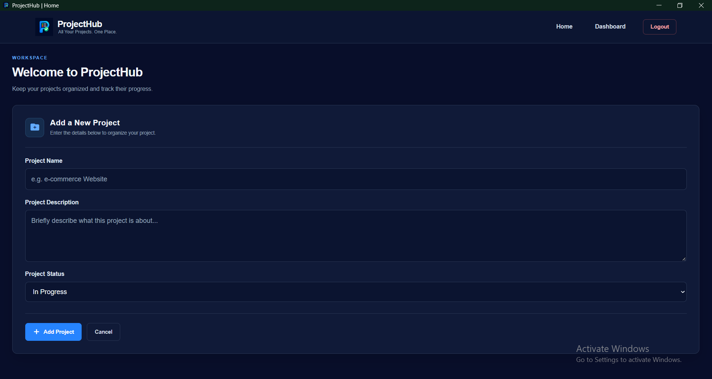
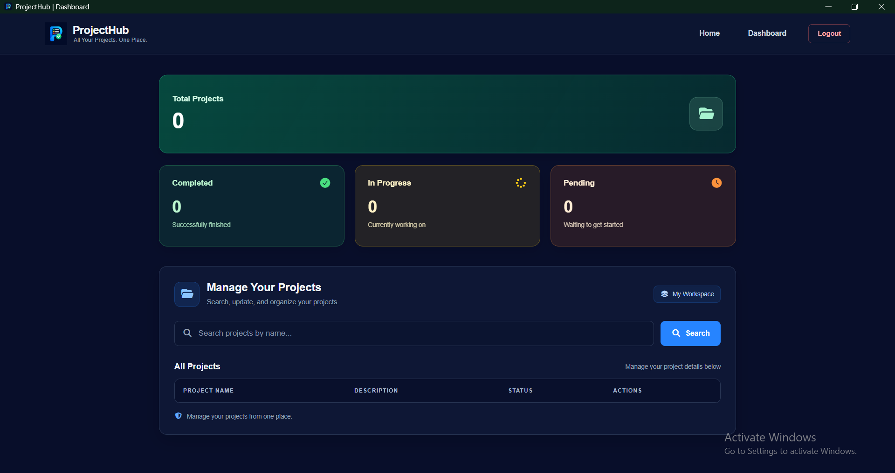

# ProjectHub

## About

- A desktop application built with Python, the Eel module, and JSON.
- I use this app to manage my own projects. I converted it into an `.exe` file using *PyInstaller*.

## Purpose of This App

- Before building this software, I wrote all my project details on paper. After some time, I lost the paper and had difficulty keeping track of all my projects and their status.
- To solve that problem, I developed this application.

## Features

- Offline
- Fast and efficient
- Desktop-based application


## Requirement:

```bash
pip install eel
```

## How to Run

```python
python project.py
```


## Preview
 
